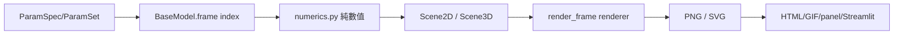
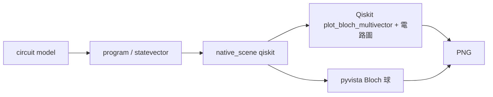
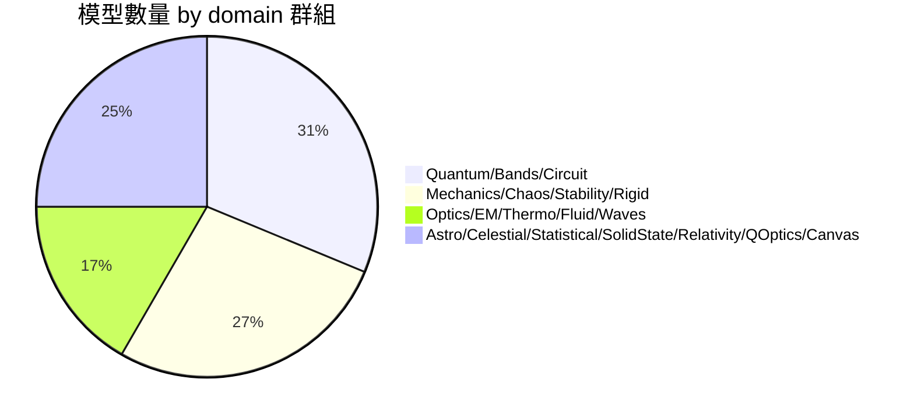
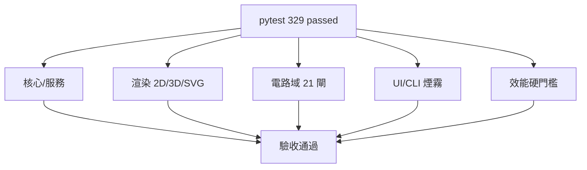

# physim 概念圖

以下以 Mermaid 表示 physim 平台的架構、資料流、領域分佈與渲染管線。

## 1. 系統架構（分層）

```mermaid
flowchart TB
    subgraph UI["上層：UI / CLI / 外部"]
        ST[Streamlit 薄外殼]
        PN[panel 獨立入口]
        CLI[CLI: list/search/info/render/animate/panel/cache]
        EXT[外部程式]
    end

    subgraph Service["服務層（唯讀）"]
        SVC[physim.service]
        CTR[physim.contracts (pydantic)]
    end

    subgraph Core["核心層（無 UI 依賴）"]
        PARAM[ParamSpec / ParamSet / Preset]
        SCENE[Scene2D / Scene3D]
        MODEL[BaseModel 協定]
        REG[Registry]
        CACHE[Render Cache]
    end

    subgraph Domains["領域層（19 domains / 48 models）"]
        Q[quantum, bands, circuit]
        M[mechanics, chaos, stability, rigid]
        O[optics, em, thermo, fluid, waves]
        A[astro, celestial, statistical, solid_state, relativity, quantum_optics, canvas]
    end

    subgraph Render["渲染層"]
        MPL[matplotlib 2D/3D fallback]
        PV[pyvista 3D 離屏]
        QK[Qiskit Bloch / 電路]
        SVG[SVG 2D]
        PLAYER[HTML/GIF 播放器]
    end

    UI --> SVC
    SVC --> CTR
    SVC --> Core
    Core --> Domains
    Domains --> SCENE
    SCENE --> Render
    Render --> PLAYER
```

## 2. 資料流（單幀）



## 3. 電路域渲染管線



## 4. 領域分布



## 5. UI 深連結優先序


## 6. 測試與驗收對應

